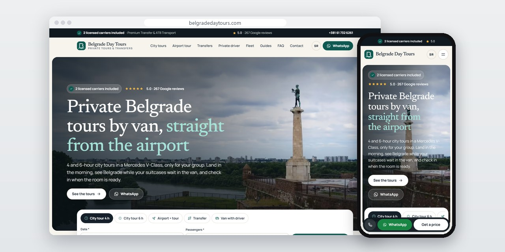
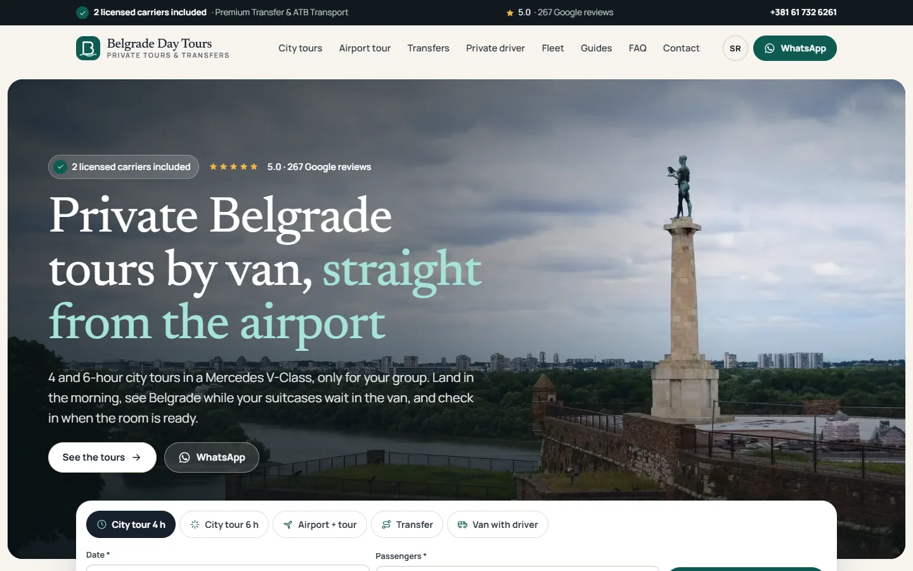
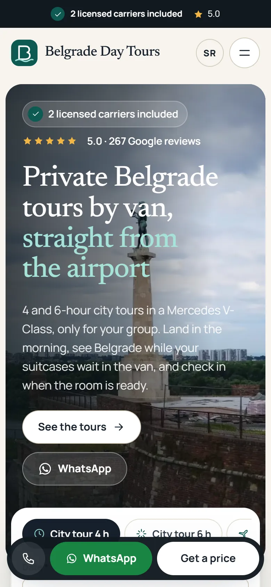
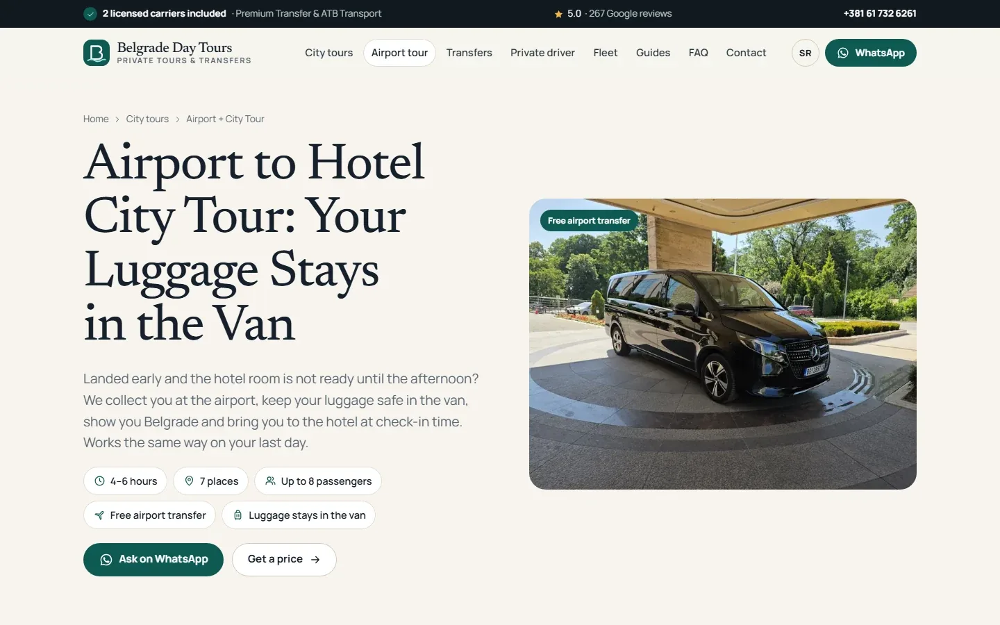
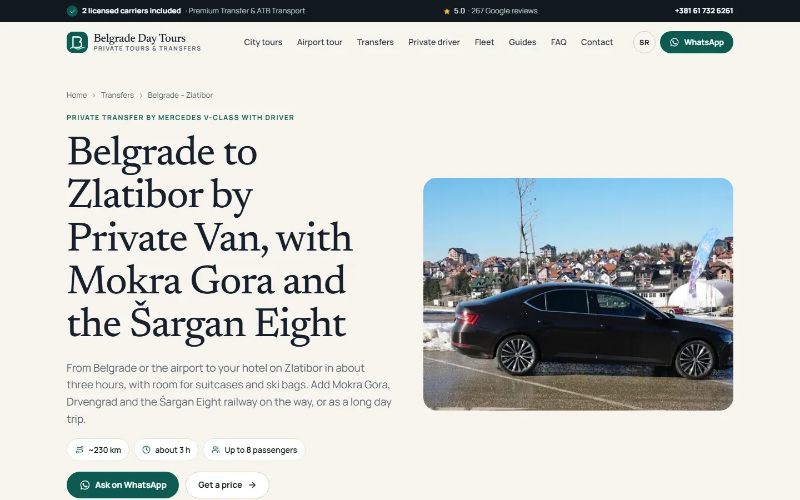

# Belgrade Day Tours

A bilingual site for private van tours of Belgrade and Serbia, including a tour from the airport to the hotel while the luggage stays in the van.

**[belgradedaytours.com](https://belgradedaytours.com/)** · [Case study](https://svilenkovic.com/portfolio/belgrade-day-tours) · [Srpski](README.sr.md)

> [!NOTE]
> Client project. The source code belongs to the client and stays in a private repository. This page describes what I built and how.

<table>
  <tr><td><b>Client</b></td><td>Premium Transfer and ATB Transport</td></tr>
  <tr><td><b>Industry</b></td><td>Private tours and day trips by van</td></tr>
  <tr><td><b>Location</b></td><td>Belgrade, Serbia</td></tr>
  <tr><td><b>Type</b></td><td>Bilingual multi-page website</td></tr>
  <tr><td><b>My role</b></td><td>Design, development, SEO and hosting</td></tr>
  <tr><td><b>Stack</b></td><td>Astro 7, TypeScript, AVIF, WebP, JSON-LD</td></tr>
</table>

## About the project

Belgrade Day Tours is the joint site of two Belgrade transport companies, Premium Transfer and ATB Transport, which drive airport guests, business clients and families every day. Their passengers kept asking the same thing: how to see Belgrade while waiting for a hotel room or the next flight. The site sells only a whole vehicle for one group, never a single seat.

The most important page is the tour from the airport to the hotel. The driver waits at arrivals, the suitcases stay locked in the van, the group sees Kalemegdan, the center, the Church of Saint Sava and Zemun, and gets to the hotel when the room is ready. The companies arrange everything with guests by message, so the inquiry form sends nothing to a server: the visitor picks the tour, date, number of passengers and suitcases, and the site turns that into a message that opens in WhatsApp or Viber for the guest to send.

## What I built

- 74 pages, 37 in English at the root and 37 in Serbian under /sr/, with hreflang tags
- Five Belgrade tours, including a layover tour between two flights, each with a route and rough times for every stop
- Ten day trips across Serbia with a plan for the day, from Novi Sad and Zlatibor to Golubac and Fruška gora
- Ten travel guides, such as how much of Belgrade fits into a layover and where to leave luggage at the airport
- Vehicle and destination photos taken by the companies, and Belgrade landmarks from Wikimedia Commons with author and license credits
- An inquiry form that builds a WhatsApp or Viber message, and a call, WhatsApp and inquiry bar on phones

## Results

| | Performance | Accessibility | Best practices | SEO |
| :-- | :-: | :-: | :-: | :-: |
| Mobile | 100 | 100 | 100 | 100 |
| Desktop | 100 | 100 | 100 | 100 |

PageSpeed Insights, lab test of the live site, November 2026. Security headers: 6 of 6. axe accessibility check: no violations. Structured data: `LocalBusiness`, `TravelAgency`.

## Screenshots

<table>
  <tr>
    <td width="68%" valign="top"></td>
    <td width="32%" valign="top"></td>
  </tr>
</table>

The tour from the airport to the hotel: the suitcases stay in the van while the group sees the city

A day trip to Zlatibor with Mokra Gora and the Šargan Eight railway, with a photo taken by the company

---

Built by [D. Svilenković](https://svilenkovic.com).
