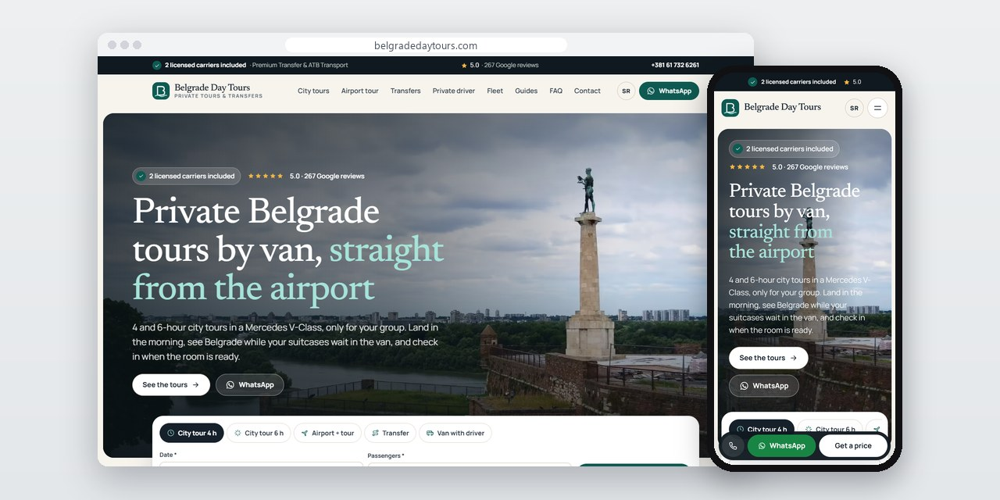
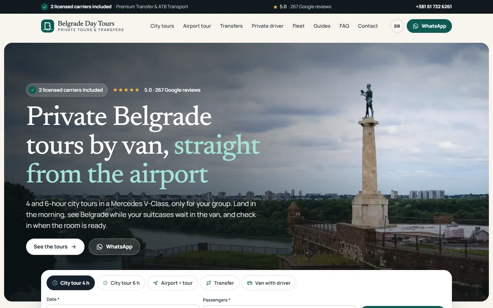
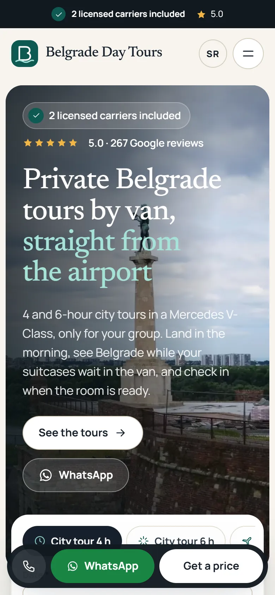
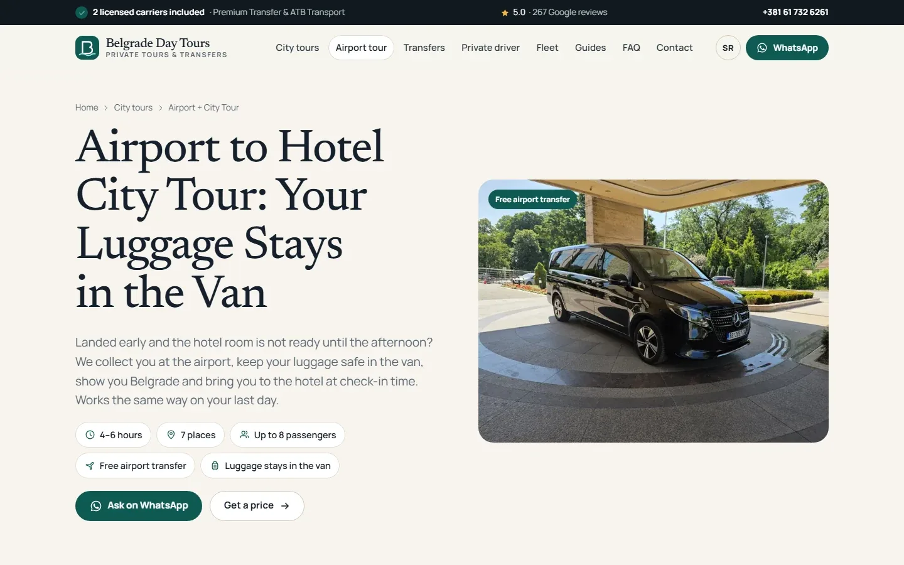
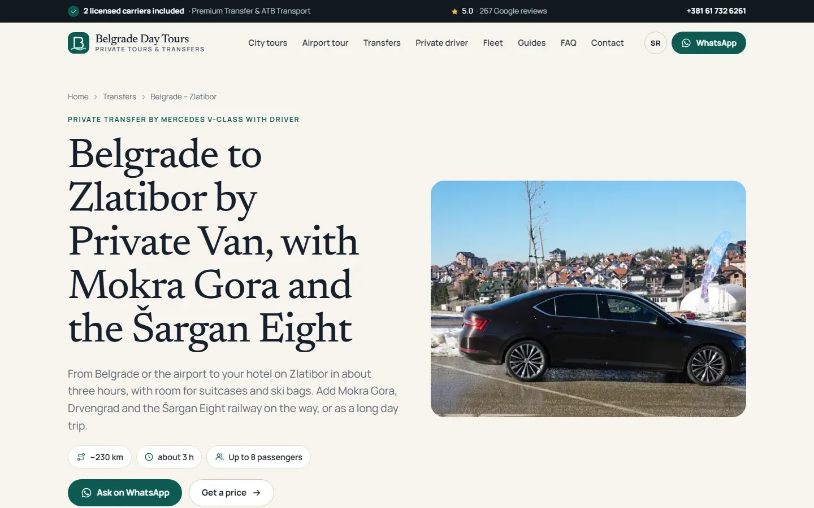

# Belgrade Day Tours

Dvojezični sajt za privatne ture kombijem po Beogradu i Srbiji, sa turom od aerodroma do hotela dok prtljag ostaje u kombiju.

**[belgradedaytours.com](https://belgradedaytours.com/)** · [Studija slučaja](https://svilenkovic.rs/radovi/belgrade-day-tours) · [English](README.md)

> [!NOTE]
> Klijentski projekat. Izvorni kod pripada klijentu i čuva se u privatnom repozitorijumu. Ova stranica opisuje šta sam uradio i kako.

<table>
  <tr><td><b>Klijent</b></td><td>Premium Transfer i ATB Transport</td></tr>
  <tr><td><b>Delatnost</b></td><td>Privatne ture i izleti kombijem</td></tr>
  <tr><td><b>Lokacija</b></td><td>Beograd</td></tr>
  <tr><td><b>Vrsta</b></td><td>Dvojezični sajt sa više strana</td></tr>
  <tr><td><b>Moj deo posla</b></td><td>Dizajn, izrada, SEO i hosting</td></tr>
  <tr><td><b>Tehnologije</b></td><td>Astro 7, TypeScript, AVIF, WebP, JSON-LD</td></tr>
</table>

## O projektu

Belgrade Day Tours je zajednički sajt dva beogradska prevoznika, Premium Transfer i ATB Transport, koji svakodnevno voze goste sa aerodroma, poslovne klijente i porodice. Putnici su ih često pitali isto: kako da vide Beograd dok čekaju sobu u hotelu ili sledeći let. Sajt prodaje samo celo vozilo za jednu grupu, nikad pojedinačno mesto.

Najvažnija strana je tura od aerodroma do hotela. Vozač čeka u dolasku, koferi ostaju zaključani u kombiju, grupa obiđe Kalemegdan, centar, Hram Svetog Save i Zemun, pa stiže u hotel kada je soba spremna. Prevoznici se sa gostima dogovaraju porukama, pa forma ne šalje ništa na server: posetilac izabere turu, datum, broj putnika i kofera, a sajt od toga sastavi poruku koja se otvori u WhatsApp-u ili Viberu i gost je sam pošalje.

## Šta sam uradio

- 74 strane, 37 na engleskom na glavnoj adresi i 37 na srpskom pod /sr/, sa hreflang oznakama
- Pet tura po Beogradu, među njima tura za presedanje između dva leta, svaka sa rutom i okvirnim vremenom po stanici
- Deset izleta po Srbiji sa planom dana, od Novog Sada i Zlatibora do Golupca i Fruške gore
- Deset vodiča, na primer koliko se Beograda vidi za vreme presedanja i gde ostaviti prtljag na aerodromu
- Fotografije vozila i destinacija koje su snimili prevoznici i beogradske znamenitosti sa Wikimedia Commons, sa autorom i licencom
- Forma za upit koja sastavlja poruku za WhatsApp ili Viber i traka sa pozivom, WhatsApp-om i upitom na telefonu

## Merenja

| | Performanse | Pristupačnost | Dobre prakse | SEO |
| :-- | :-: | :-: | :-: | :-: |
| Telefon | 100 | 100 | 100 | 100 |
| Desktop | 100 | 100 | 100 | 100 |

PageSpeed Insights, laboratorijsko merenje živog sajta, novembar 2026. Sigurnosna zaglavlja: 6 od 6. axe provera pristupačnosti: bez prekršaja. Strukturisani podaci: `LocalBusiness`, `TravelAgency`.

## Snimci ekrana

<table>
  <tr>
    <td width="68%" valign="top"></td>
    <td width="32%" valign="top"></td>
  </tr>
</table>

Tura od aerodroma do hotela: koferi ostaju u kombiju dok traje obilazak grada

Izlet na Zlatibor sa Mokrom Gorom i Šarganskom osmicom, sa fotografijom koju je snimio prevoznik

---

Izrada: [D. Svilenković](https://svilenkovic.rs).
